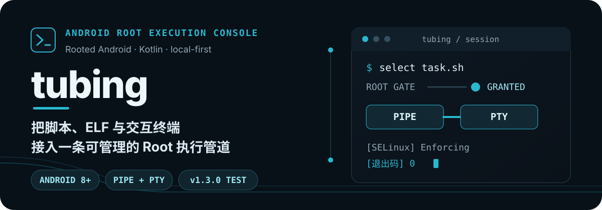
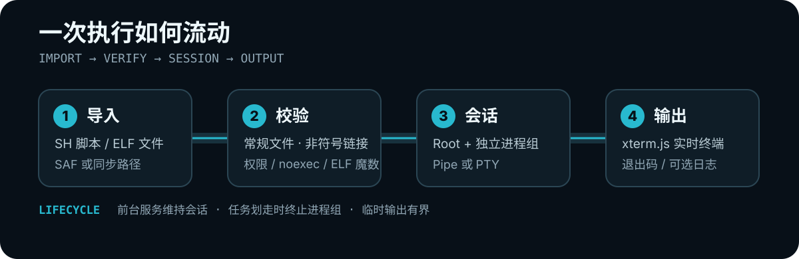

<p align="center">
  
</p>

<p align="center">
  <a href="https://github.com/givsk983/tubing/releases/tag/v1.4.0"></a>
  
  
  
</p>

<p align="center">
  在 Android 上导入、管理并以 Root 权限运行 SH 脚本或 ELF 文件。<br>
  需要逐行输入时使用 Pipe，需要完整终端语义时切换 PTY。
</p>

<p align="center">
  <a href="https://github.com/givsk983/tubing/releases/download/v1.4.0/tubing-v1.4.0.apk">下载 APK</a>
  · <a href="#快速开始">快速开始</a>
  · <a href="./ARCHITECTURE.md">架构说明</a>
  · <a href="./TESTING.md">测试清单</a>
  · <a href="https://t.me/mbazhuan">Telegram 反馈</a>
</p>

> [!WARNING]
> tubing 会在设备上执行 Root 命令。请只导入你已阅读并信任的文件。当前 `v1.4.0` 是 Debug 签名测试版，不同 Root 管理器、输入法与 OEM 后台策略仍需真机验证。

## 它解决什么问题

很多 Root 脚本不只是“一次点击”：它们需要交互输入、持续输出、后台存活、可追踪日志，偶尔还要完整的终端能力。tubing 把这些环节放在一个本地 Android 应用里，并让每次执行都经过明确的授权、校验与生命周期管理。

| 能力 | 你会得到什么 |
| --- | --- |
| 双执行后端 | Pipe 适合普通脚本与逐行输入；PTY 适合密码隐藏、单键读取、方向键菜单与全屏终端程序 |
| Root 会话 | 每次运行前重新确认 Root、权限、SELinux 状态与 `noexec` 挂载限制 |
| 交互终端 | 内置离线 xterm.js，流式显示 ANSI 输出并接收键盘与输入法内容 |
| 快捷启动 | 为脚本绑定输入方案，使用简洁首页一键启动；也可随时切回完整界面 |
| 文件管理 | 双栏浏览已导入目录与设备存储，支持复制、重命名、删除、新建目录、路径收藏和 ZIP 解压 |
| 会话与记录 | 默认保留最近 50 次执行，可调整保留次数并保存日志；任务被划走时尝试终止对应进程组 |

点击 ZIP 可浏览内部目录、预览文件内容；长按选择文件或文件夹，再点击“解压所选”，直接解压到另一侧目录或压缩包所在目录。已有同名目标不会被覆盖。

文件管理双栏支持左右滑动文件或文件夹进入选择模式。左滑追加当前项；第一次右滑选中当前项，后续右滑按当前列表顺序追加选中“上次右滑项到本次右滑项”的完整范围（包含两端，支持向上选）。选择模式中点按只追加选择，重复点按保持选中，不打开文件夹或 ZIP，也不改变右滑范围起点。左右栏分别记录选择，可通过“所选操作”复制或删除，多选时删除会二次确认；单选仍可重命名或解压 ZIP。点击“取消选择”或按返回键退出；进入其他目录清空该栏选择，刷新保留仍存在的已选项。

在执行页点击“导入文件”，可选择“内置文件管理器”“MT 管理器”或“手机文件管理器”。设置页的“默认导入方式”可设为每次询问，或固定使用其中一种；临时切换来源不会改变默认设置。MT 同时支持标准版与 Canary 版，未安装时可改选其他来源。

内置文件管理器默认浏览下载目录，每个普通文件左侧有独立勾选框，点击可选中或取消，不会打开 ZIP；左右滑动仍可选中，连续右滑可范围选中，再点击底部“导入所选”批量导入。左右栏独立选择，每次导入当前栏的已选文件；进入其他目录会清空该栏选择。SH 和 ELF 统一导入 `/data/adb/root_executor` 脚本库，不再按类型分目录；失败项保留选择并显示原因，成功项不会重复导入，全部成功后返回执行页，不自动运行。

从任一来源选中 ZIP，或点击内置管理器中的 ZIP 文件名，会先显示“ZIP 导入方式”。可以将整个 ZIP 解压为一个项目，项目名称默认 ZIP 文件名去掉 `.zip`，也可手动修改；所有目录、程序和资源保存在 `/data/adb/root_executor/项目名称`，重名时拒绝覆盖。项目内的 SH / ELF 程序会出现在执行列表中，并从程序所在目录启动。也可选择“浏览并选择包内文件”，继续使用原有预览与挑选导入功能。ZIP 与普通文件需分开选择。

“更多导入”可临时切换来源或选择同步路径；底部导航栏上滑可使用收藏路径。目录与符号链接不能作为普通待导入文件，其他类型文件导入时显示错误。

文件管理底部导航栏上滑后，可在“收藏 / 最近”之间切换。“最近”保存最近成功访问的 20 个目录，重复访问会移到最前面，普通刷新不会改变顺序，重启后保留。点击记录在当前文件栏打开；“清空最近”只清除记录，不影响收藏或文件。

“选择文件”首页将 ZIP 项目显示为单独文件夹，不再把项目里的所有程序混排。点项目后可按内部目录逐层浏览，点具体程序完成选择；上级按钮和返回键都能返回上一层。单独导入的程序与旧目录中的程序仍可在首页直接选择。

## 执行路径

文件管理中长按普通文件，在菜单中选择“执行”，会校验 SH / ELF 后直接从原目录启动，无需先导入。项目内程序会保留项目身份；库外程序使用原路径并保留相对资源访问。非程序文件与符号链接会被拒绝，已有任务运行时不会并发启动新任务。共享存储中的 SH 使用 `sh` 读取执行；ELF 仍受目标挂载的 `noexec` 限制。

<p align="center">
  
</p>

所有托管文件位于：

```text
/data/adb/root_executor/
├── example.sh    # SH 脚本与 ELF 程序直接放在根目录
├── example-elf   # 执行时自动识别 SH / ELF
├── logs/         # 可选执行日志
└── tmp/          # 会话 PID、取消标记与临时数据
```

手动复制到脚本库根目录的 `.sh` 或 ELF 文件也会出现在“选择文件”中。旧版 `scripts/`、`binaries/` 目录继续兼容读取，以保留原快捷方式、输入方案和历史关联；新增导入不再使用这两个分类目录。`logs/`、`tmp/` 仍用于内部日志和会话数据。

## 快速开始

### 1. 准备设备

- Android 8.0（API 26）或更高版本
- 可用的 `su` 实现与 Root 管理器
- 支持 `setsid` 的 Android 环境

### 2. 安装测试版

从 [GitHub Release](https://github.com/givsk983/tubing/releases/tag/v1.4.0) 下载 `tubing-v1.4.0.apk`，可通过 ADB 覆盖安装并保留数据。

```bash
adb install -r tubing-v1.4.0.apk
```

发布 APK 的 SHA-256：

```text
9a77574d110f9d3ed4c4602aedb6aed781b05851bbb0b45c3404e396b3287768
```

### 3. 完成第一次执行

1. 打开 tubing，在 Root 管理器中允许授权。
2. 导入 `.sh` 脚本或 Android 可执行 ELF 文件。
3. 选择 **Pipe** 或 **PTY** 执行方式。
4. 选中文件并启动，在终端中查看输出、提交输入与确认退出码。

## Pipe 还是 PTY？

| 场景 | Pipe | PTY |
| --- | :---: | :---: |
| 普通命令、逐行文本输入 | ✅ 推荐 | ✅ |
| 无换行提示的即时输出 | ✅ | ✅ |
| 隐藏密码输入（`stty -echo`） | — | ✅ 推荐 |
| 单键读取、方向键菜单、全屏 TUI | — | ✅ 推荐 |
| 最少依赖，不加载 JNA | ✅ | — |

Pipe 模式会在按下回车后提交一行输入；程序自身的缓冲仍可能让提示延迟。需要真实终端尺寸、回显控制或原始按键时，请使用 PTY。

## 从源码构建

需要 JDK 17 与 Android SDK 35。Windows 下可直接运行：

```powershell
.\gradlew.bat testDebugUnitTest
.\gradlew.bat assembleDebug
.\gradlew.bat lintDebug
```

Debug APK 输出到：

```text
app/build/outputs/apk/debug/app-debug.apk
```

> `local.properties` 与仓库中的本地 SDK 目录均为机器专属配置，不应提交。

## 安全边界

tubing 尽量缩小高权限操作的意外范围，但它不是 Root 沙箱：

- Root 文件操作集中在 `RootExecutor`，每次操作只调用一次 `su -c`，不嵌套提权。
- 导入、修改与执行前检查目录、常规文件、符号链接、文件权限及名称。
- Shell 参数使用单引号转义；导入名称经过保守字符过滤并添加随机后缀。
- ELF 文件会检查魔数；运行前会重新应用并验证权限，同时检查 `noexec`。
- 强行停止、断电、OEM 进程清理或脚本主动守护化，无法保证触发正常的会话清理。
- Pipe 模式不能遵守终端密码回显控制；敏感输入请使用 PTY，并谨慎启用输入记忆。

更完整的实现与限制见 [ARCHITECTURE.md](./ARCHITECTURE.md)。

## 项目结构

```text
app/src/main/java/com/stealth/rootexecutor/
├── MainActivity.kt       # 授权、终端、文件管理与设置界面
├── ExecutionService.kt   # 前台服务、会话状态与生命周期
├── ExecutionHistory.kt   # 脚本执行历史与结果持久化
├── RootExecutor.kt       # Root 文件操作、校验与启动命令
├── PipeSession.kt        # 标准输入输出管道后端
├── PtySession.kt         # 基于 Bionic/JNA 的 PTY 后端
└── PipeInput.kt          # Pipe 行编辑、控制键与本地回显
```

## 当前状态

`v1.4.0` 已包含快捷/完整界面、执行历史、输入记忆与方案、快捷方式、双栏文件管理、路径收藏，以及 Pipe/PTY 两种执行后端，并支持从 ZIP 预览、多选并统一导入 SH/ELF 文件。构建包仍标记为测试版；Root、SELinux、锁屏、任务划走与输入法兼容性请按 [TESTING.md](./TESTING.md) 在真实设备上验证。

## 第三方组件与许可

- [xterm.js 5.5.0](https://github.com/xtermjs/xterm.js) — MIT License
- [JNA 5.15.0](https://github.com/java-native-access/jna) — Apache License 2.0 选项

详情见 [THIRD_PARTY.md](./THIRD_PARTY.md)。当前仓库尚未提供项目级 `LICENSE` 文件；在许可证明确前，请勿假定代码可被复制、修改或再分发。

## 反馈

发现兼容性问题时，请附上 Android 版本、Root 方案、所选执行模式与可脱敏的终端输出：

- [GitHub Issues](https://github.com/givsk983/tubing/issues)
- [Telegram 反馈频道](https://t.me/mbazhuan)
